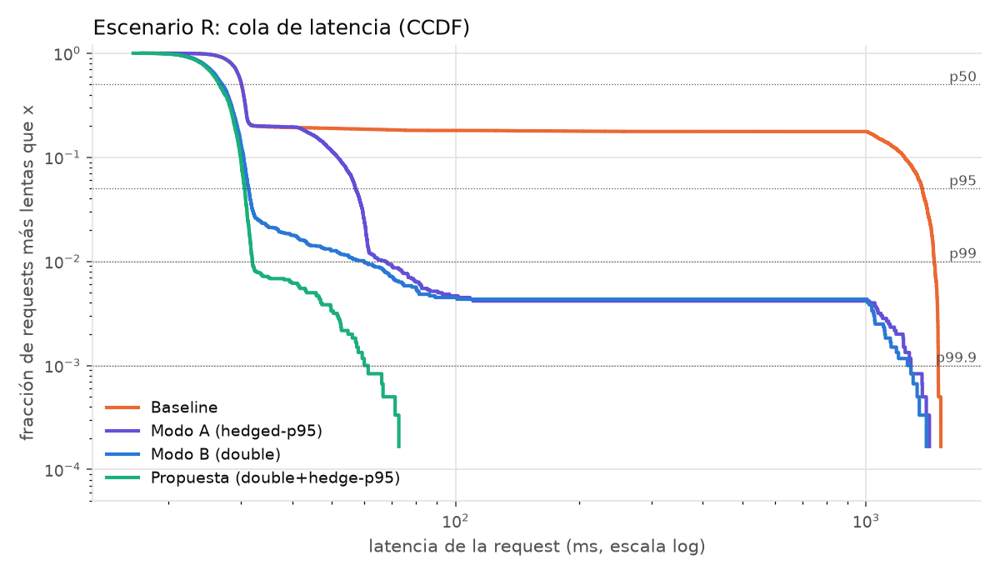
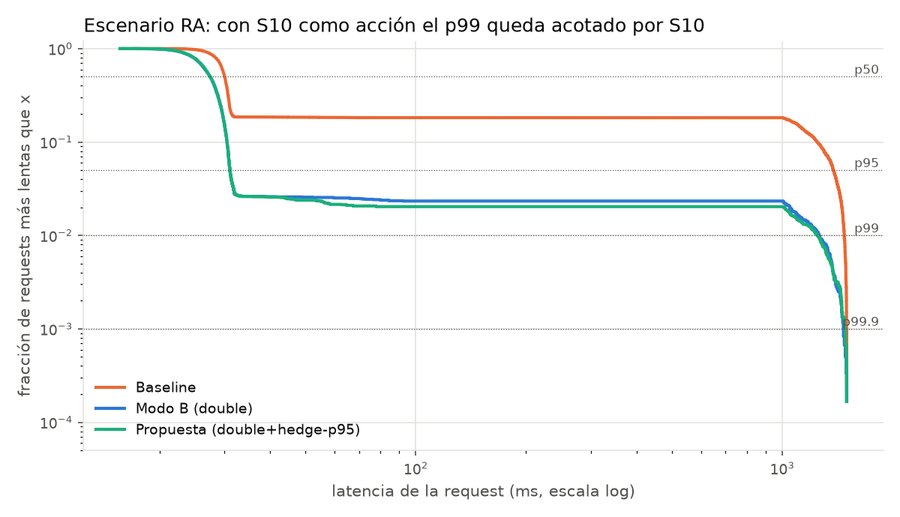
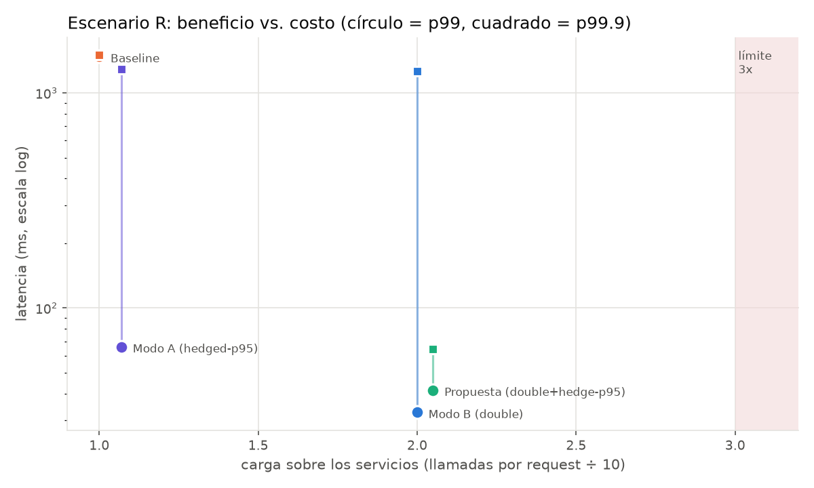
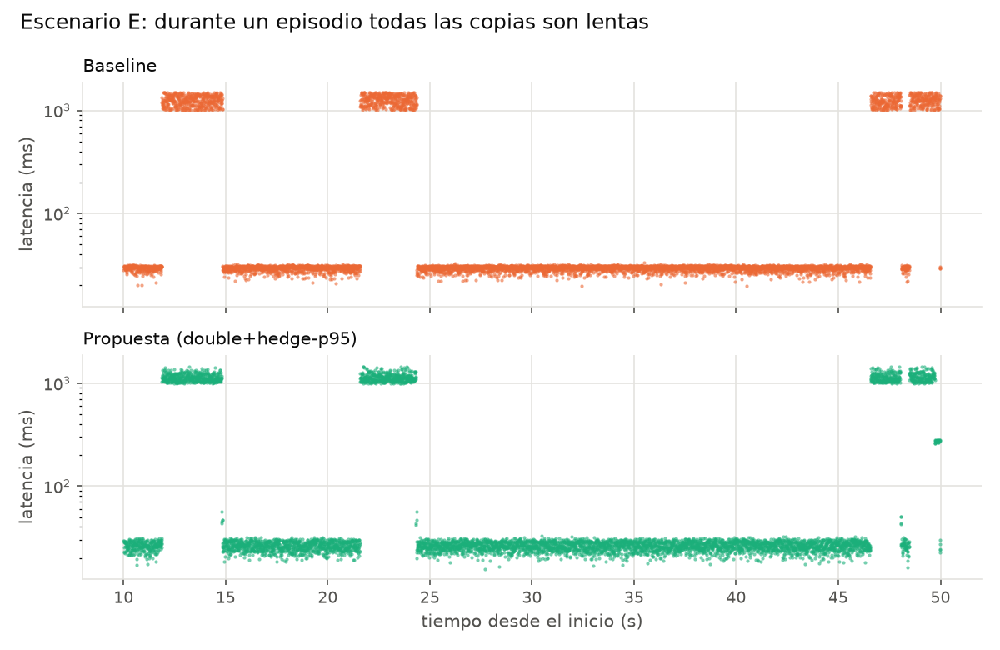

# Resultados del experimento

Carga open-loop de **150 req/s**, 40 s medidos por corrida (+10 s de warm-up), **3 repeticiones** por configuración con semillas distintas. Cada métrica es la mediana de las repeticiones, las requests y llamadas son la suma. Restricción de costo: carga ≤ 3.0x sobre los servicios.

**Propuesta:** double+hedge-p95. Cada lectura sale con 2 copias en t = 0 y, si ninguna respondió al p95 observado del servicio, se manda una 3ra.

## R. Lentitud por request, los 10 servicios son lectura

| Métrica | Baseline | Modo A (hedged-p95) | Modo B (double) | Propuesta (double+hedge-p95) |
|---|---:|---:|---:|---:|
| p50 | 29.9 ms | 30.1 ms (+1%) | 26.8 ms (-11%) | 26.8 ms (-10%) |
| p95 | 1.37 s | 57.1 ms (-96%) | 30.7 ms (-98%) | 30.9 ms (-98%) |
| p99 | 1.47 s | 66.0 ms (-96%) | 32.7 ms (-98%) | 41.5 ms (-97%) |
| p99.9 | 1.50 s | 1.29 s (-14%) | 1.26 s (-16%) | 64.4 ms (-96%) |
| p99 [min-max entre repeticiones] | 1466-1482 ms | 60-67 ms | 32-58 ms | 32-46 ms |
| Requests ejecutadas (cliente → API) | 18,000 | 18,000 | 18,000 | 18,000 |
| Llamadas internas a servicios (costo) | 180,000 | 191,978 | 360,000 | 369,011 |
| Carga sobre los servicios | x1.00 | x1.07 | x2.00 | x2.05 |
| Requests > 100 ms | 18.27% | 0.45% | 0.43% | 0.00% |
| Errores | 0 | 0 | 0 | 0 |

## RA. Igual que R pero S10 es una acción y nunca se duplica

| Métrica | Baseline | Modo A (hedged-p95) | Modo B (double) | Propuesta (double+hedge-p95) |
|---|---:|---:|---:|---:|
| p50 | 30.0 ms | 29.9 ms (-1%) | 27.5 ms (-8%) | 27.4 ms (-9%) |
| p95 | 1.38 s | 57.5 ms (-96%) | 31.2 ms (-98%) | 31.1 ms (-98%) |
| p99 | 1.48 s | 1.23 s (-16%) | 1.26 s (-15%) | 1.24 s (-16%) |
| p99.9 | 1.50 s | 1.48 s (-1%) | 1.47 s (-2%) | 1.48 s (-1%) |
| p99 [min-max entre repeticiones] | 1476-1479 ms | 1215-1299 ms | 1241-1313 ms | 1198-1302 ms |
| Requests ejecutadas (cliente → API) | 18,000 | 18,000 | 18,000 | 18,000 |
| Llamadas internas a servicios (costo) | 180,000 | 191,161 | 342,000 | 350,111 |
| Carga sobre los servicios | x1.00 | x1.06 | x1.90 | x1.94 |
| Requests > 100 ms | 18.22% | 2.27% | 2.63% | 2.02% |
| Errores | 0 | 0 | 0 | 0 |

## E. Episodios, S7 y S8 se degradan por completo ~1.5 s cada ~20 s

| Métrica | Baseline | Modo A (hedged-p95) | Modo B (double) | Propuesta (double+hedge-p95) |
|---|---:|---:|---:|---:|
| p50 | 29.8 ms | 29.9 ms (+0%) | 27.2 ms (-9%) | 27.4 ms (-8%) |
| p95 | 1.36 s | 1.27 s (-7%) | 1.25 s (-8%) | 1.19 s (-12%) |
| p99 | 1.47 s | 1.41 s (-4%) | 1.38 s (-6%) | 1.33 s (-9%) |
| p99.9 | 1.50 s | 1.48 s (-1%) | 1.46 s (-2%) | 1.45 s (-3%) |
| p99 [min-max entre repeticiones] | 1461-1478 ms | 1377-1409 ms | 1370-1399 ms | 1292-1342 ms |
| Requests ejecutadas (cliente → API) | 18,000 | 18,000 | 18,000 | 18,000 |
| Llamadas internas a servicios (costo) | 180,000 | 191,286 | 360,000 | 371,312 |
| Carga sobre los servicios | x1.00 | x1.06 | x2.00 | x2.06 |
| Requests > 100 ms | 18.75% | 18.47% | 18.75% | 18.45% |
| Errores | 0 | 0 | 0 | 0 |

## Gráficas

